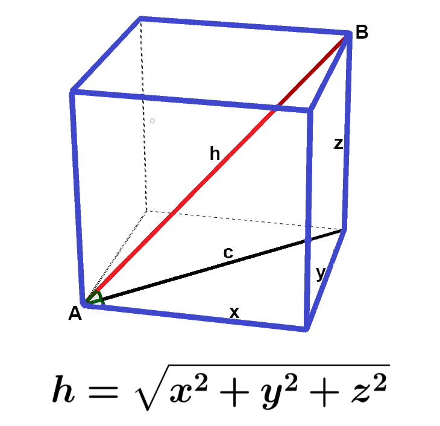
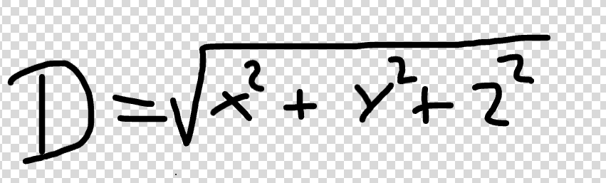
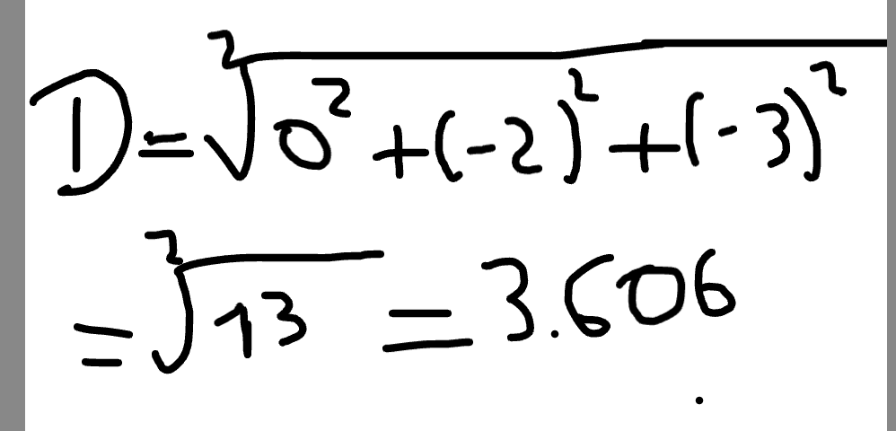
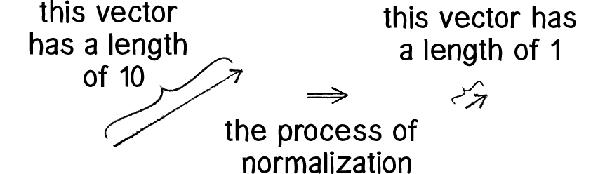
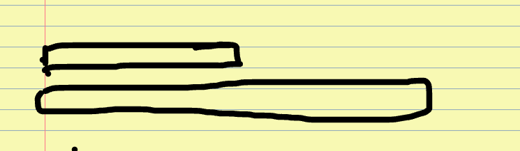

# Camera

Vamos falar da camera, um dos componentes mais importantes para o jogo.

Para nos comercar a fazer a camera, é necessario que voce entenda os seguintes conceitos:

# Vetores

Antes de comecarmos qualquer coisas, voce precisa obrigatoriamente entender como representar posicoes e direcoes.

## O que é um vetor?

No mundo 3d, nos usamos tres coordenadas, que sao elas:

- X = O 'X' representa a esquerda e direita 
- Y = O 'Y' é o que chamamos de vertical, ou seja, se move de cima para baixo
- Z = O 'Z' Representa a profundidade, ou seja, pra frente, e para tras.

Outra coisa que vou adiantar logo de cara pra voces, a posicao nao e a mesma coisa que direcao.

A posicao diz onde a camera esta, Ex.: (0,2,3) significa que ela esta dois metros acima e trez unidades do eixo Z. Ja a *direcao* ela diz pra onde a camera aponta, uma direcao pode ser representada por (0,0,-1), que quer dizer que ela aponta para o sentido negativo de Z.

A diferenca entre eles e basicamente isso: a poiscao ela indentifica um ponto por sua vez, a direcao representa para onde tu ta vai ou olha

## Tamanho do vetor

Para calcularmos o comprimento de um vetor, precisamos usar o teorema de pitaguras(Aquilo que voce viu ano passado e pensou que nao ia servir pra nada)

- Porque devemos fazer isso?

Olha, vou te mostrar o porque.

A camera esta olhando para essa posicao: C = (0, 2, 3), e centro cdo chao é T = (0, 0, 0), calculamos a direcao subtraindo a posica da camera da posicao do alvo

D = T - C = (0, -2, -3)

Esse vetor aponta na direcao do chao, mas tem um detalhe muito importante, ela tambem tem um comprimento.

Vamos calcular o do teorema de pitagoras agora:

Substituindo os valores:

Isso quer dizer que o vetor tem um comprimento mais omeno 3,606.

## Normalizacao de vetores

Voce deve esta se perguntando: - O que voce quer dizer com normalizar vetor?
Normalizar um vetor e o mesmo que manter a direcao, mas alterando seu comprimento para que seja sempre 1. Pra fazer isso, precisamos dividir cada componente pelo comprimento do vetor, podemos fazer Dn = D / D

Ainda nao entendeu? 
Vamos novamente, voce tem um pedaco de pau.

o de cima que e mais pequeno, e o de baixo que é bem grandao.

Mas se voce reparar bem, vai perceber que os dois apontam para o mesmo canto mesmo sendo de tamanhos diferentes.

por isso que normalizamos um vetor, para transforma esse vetor maior em 1, sem mudar para onde ele aponta. 
